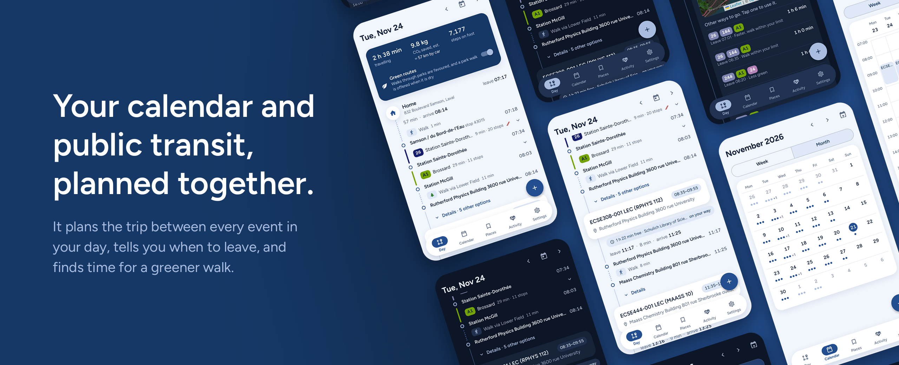
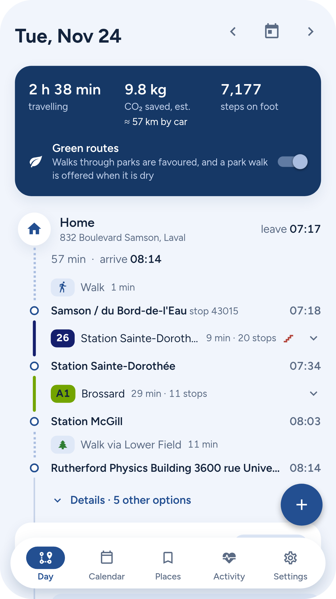
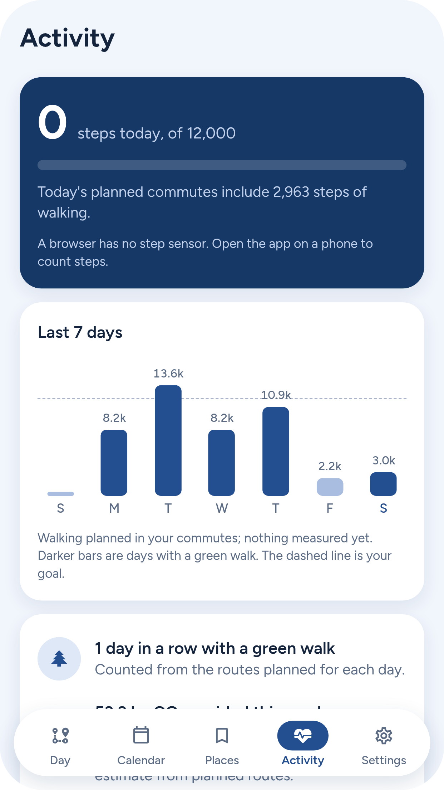

<p align="center">
  
</p>

<h1 align="center">Tandem</h1>

<p align="center">
  
  
  
  
</p>

<p align="center">
  
</p>

<p align="center">A day planner for greater Montreal that joins your calendar with public transit.</p>

---

## Contents

- [What it does](#what-it-does)
- [How it works](#how-it-works)
- [Quick start](#quick-start)
- [Commands](#commands)
- [Configuration](#configuration)
- [Project layout](#project-layout)
- [Status and limits](#status-and-limits)
- [Data and attribution](#data-and-attribution)

## What it does

Routes are planned from the calendar, not from a search box: the app already knows where you have to be and when.

- **Routes between events.** Each day starts and ends at home (or a place you choose for that day). Every trip is planned to arrive before the event, so its departure time is your time to leave.
- **Time-to-leave reminders.** Local notifications 10 minutes before and at the moment to leave (phone only).
- **Ranked for you.** Routes are ordered by your settings (preferred and avoided modes, longest walk, step-free only) and by what you actually pick: choosing an alternative teaches a small ranking agent.
- **Green routes.** One switch favours walks through parks, marks them with a pine tree, and on short trips in dry weather offers a walk routed through a park.
- **Free-time suggestions.** When there is slack before you need to leave, the app suggests a café, library or park that fits.
- **Impact at a glance.** Time travelling, steps on foot, and CO₂ saved against driving, with a plain comparison such as "≈ 49 km by car".
- **Calendar.** Week and month views, add and edit events, import an `.ics` file, optional Google Calendar sync.
- **Saved places.** Keep the places you go to often and pick them as an event's location or a day's start or end.
- **Step counting.** From the phone's own pedometer, with a seven-day chart and a green-walk streak.
- **Light and dark themes.**

<p align="center">
  
  &nbsp;&nbsp;&nbsp;
  
</p>

<p align="center"><sub>Day, with green routes on &nbsp;·&nbsp; Activity</sub></p>

## How it works

Pathfinding is done by a transit engine. The app's own logic only chooses between the routes it returns.

| Step | Who | What |
|------|-----|------|
| 1. Candidates | Transit engine ([MOTIS](https://github.com/motis-project/motis), public [Transitous](https://transitous.org) server or a local build) | Real itineraries on real timetables for "arrive at B by 11:50" |
| 2. Enrichment | Go backend | Steps, CO₂ against a car, share of the walk in green space, step-free access, slack before leaving |
| 3. Ranking | Go backend + Python agent | `score = weights · features`; weights come from your settings plus what the agent learned from your past choices |
| 4. Feedback | App → backend → agent | Picking an alternative pins it for that trip and becomes a training example |

```
 React Native app (Expo)
        │ REST/JSON
        ▼
 Go backend ──────────────► MOTIS / Transitous   (pathfinding, geocoding)
   │  enrich + rank    └──► Open-Meteo           (weather)
   │  POST /rank, /feedback
   ▼
 Python ML agent            (optional: the backend falls back to settings-only ranking)
```

More detail: [docs/ARCHITECTURE.md](docs/ARCHITECTURE.md) (design reasoning and a per-feature status table) and [docs/API_SPEC.md](docs/API_SPEC.md) (REST endpoints).

## Quick start

**You need:** Go 1.26+, Node.js 18+ with npm, Python 3.10+.

```bash
git clone git@github.com:nim-sam/tandem.git
cd tandem
make setup      # install backend, frontend and ML agent dependencies
make dev-web    # start everything and open the app in the browser
```

`make dev` does the same without opening a browser (press `w` for web or `a` for Android in the Expo prompt), and `make dev-android` opens the app in an Android emulator. Quitting Expo stops the backend and the agent.

The app starts empty. Set a home address in Settings, add a few events with addresses, and the Day tab plans the routes.

<details>
<summary><b>Laval and exo coverage: build the local routing engine</b></summary>

<br>

The public Transitous server has no timetable for the STL (Laval), so trips to, from or across Laval come back as long detours. To route on every agency of the region (STM, STL, RTL, REM, exo buses and commuter trains):

```bash
make routing    # a few minutes, about 2 GB in ./routing
```

`make dev` then uses the local engine automatically. Rebuild every few weeks: agencies publish new timetables each season, and an expired timetable returns no trips. The local engine has no live delays.

</details>

<details>
<summary><b>Running on a real phone</b></summary>

<br>

On a phone, `localhost` is the phone itself. Point the app at your computer instead:

```bash
cd frontend
cp .env.example .env
# set EXPO_PUBLIC_API_URL=http://<your computer's LAN IP>:8080/api
```

Then run `make dev` and scan the QR code with Expo Go.

</details>

<details>
<summary><b>Running the services one by one, or with Docker</b></summary>

<br>

```bash
make dev-backend    # Go API on :8080 (GET /health shows provider and agent status)
make dev-ml         # ranking agent on :8000
make dev-frontend   # Expo
```

```bash
docker compose up --build   # backend on :8080 and agent on :8000
```

</details>

## Commands

| Command | What it does |
|---|---|
| `make setup` | Install dependencies for the backend, frontend and ML agent |
| `make dev` | Run the whole stack; Expo in the foreground |
| `make dev-web` | Same, opening the app in the browser |
| `make dev-android` | Same, opening the app in an Android emulator |
| `make routing` | Build the local routing engine with every Montreal-area agency |
| `make test` | Go tests, ML agent tests and the frontend typecheck |
| `make logs` | Follow the backend and ML agent logs |
| `make stop` | Stop background servers left over from `make dev` |
| `make data` | Refresh bundled data: parks, third places, step-free stations |
| `make reset-data` | Delete saved events, places, settings and planned routes |

## Configuration

All settings are optional environment variables.

| Variable | Used by | Default | Purpose |
|---|---|---|---|
| `EXPO_PUBLIC_API_URL` | app (`frontend/.env`) | `http://localhost:8080/api` | Where the app finds the backend |
| `EXPO_PUBLIC_GOOGLE_CLIENT_ID` | app (`frontend/.env`) | unset | Google OAuth client ID; shows the Google Calendar sync button |
| `TRANSIT_PROVIDER` | backend | `transitous` | `mock` runs offline with hardcoded demo routes |
| `TRANSIT_API_URL` | backend | `https://api.transitous.org` | MOTIS server to route with; `make dev` sets it to the local engine when built |
| `TRANSIT_USER_AGENT` | backend | `tandem/0.1 (hackathon prototype)` | Sent to the transit API; Transitous asks for an app name and a contact |
| `ML_AGENT_URL` | backend | `http://localhost:8000` | Ranking agent |
| `DATA_PATH` | backend | `data/app.db` | SQLite database file |
| `PORT` | backend | `8080` | Backend port |

## Project layout

```
├── backend/                     # Go REST API (:8080)
│   ├── cmd/api/                 # entry point
│   ├── internal/domain/         # entities: events, routes, preferences, ranking weights
│   ├── internal/service/        # routing, calendar, places, health, ranking
│   ├── internal/adapter/        # transit engine, .ics and Google Calendar, parks, weather, SQLite
│   └── internal/transport/http/ # handlers
├── frontend/                    # React Native app (Expo): Android, iOS, web
│   └── src/
│       ├── screens/             # Day, Calendar, Places, Activity, Settings
│       ├── components/          # CommuteCard, RouteMap, calendar grids, dialogs
│       ├── store/               # app state
│       └── theme/               # colours and type
├── ml-agent/                    # route-ranking agent (FastAPI, :8000)
├── scripts/                     # routing engine setup and bundled-data refresh
├── docs/                        # architecture, API, UI concept
├── mockups/                     # screenshots, light and dark
└── Makefile
```

## Status and limits

Tandem is a hackathon prototype for a single user.

- **No accounts.** One hardcoded user; everything is stored in `backend/data/app.db`.
- **Google Calendar sync** is hidden until OAuth client IDs are set, and has only been tested against a fake server.
- **Step counts** are exact on iOS; Android counts only while the app is open; a browser has no step sensor.
- **Time-to-leave notifications** are not available in a browser.
- **CO₂ figures** are estimates from per-mode averages, and the comparisons (car distance, gasoline, trees) are rough.
- **Step-free access** comes from a static station list, not live elevator outages.
- **Live delays** appear only with the public Transitous server and are cached for 15 minutes.

## Data and attribution

- Transit timetables: [Transitous sources](https://transitous.org/sources/) and the agencies' open data (STM, STL, RTL, REM, exo).
- Maps, parks and places: © [OpenStreetMap](https://www.openstreetmap.org/copyright) contributors.
- Weather: [Open-Meteo](https://open-meteo.com).
